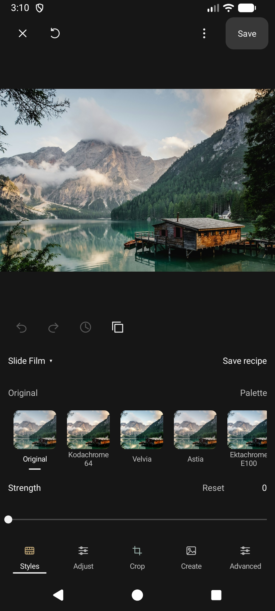
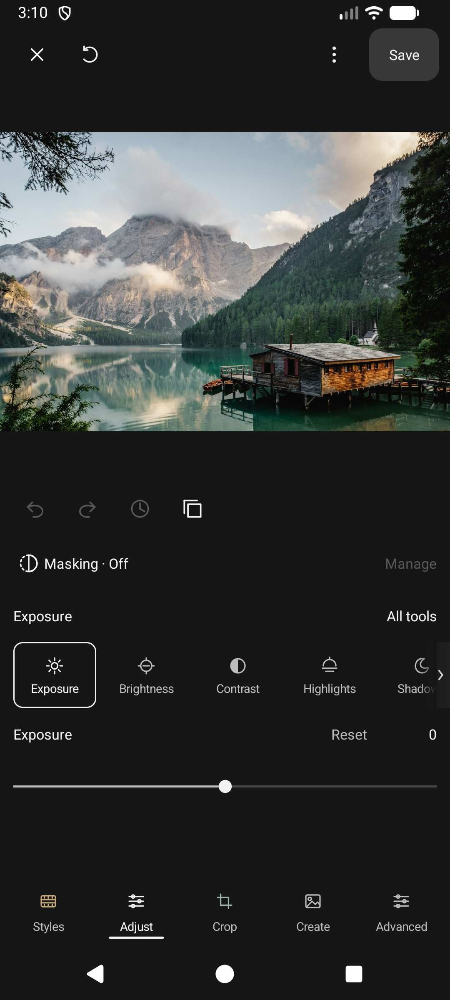
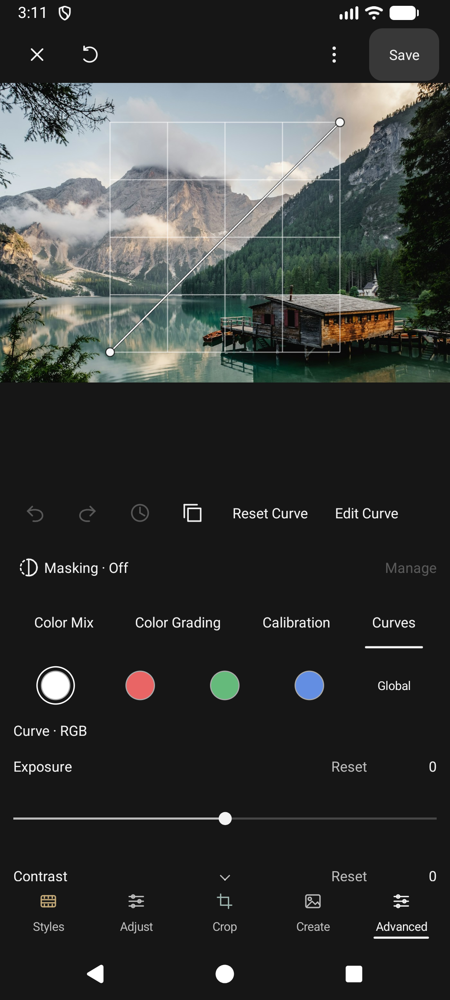

<p align="center">
  
</p>

<h1 align="center">Fotomizer for Android</h1>

<p align="center">Precise photo adjustments, expressive looks, and creative compositions.</p>
<p align="center"><strong>Android 10 or newer</strong></p>

<p align="center">
  <a href="https://github.com/dabestakoh/fotomizer-releases/releases/latest"><strong>Download the latest release</strong></a>
  &nbsp; · &nbsp;
  <a href="https://github.com/dabestakoh/fotomizer-releases/releases">Browse all versions</a>
</p>

## Make the photo your own

- **Adjust:** exposure, contrast, color, detail, curves, crop, and borders.
- **Style:** film-inspired looks, imported presets, saved recipes, Flash, Mist, and creative light effects.
- **Refine:** on-device subject and sky selection, brush refinement, and linear/radial masks.
- **Create:** Template and Freeform collages, grids, carousels, double exposure, text, and overlays.
- **Reuse:** Copy edits, save recipes, and reopen editable creations.

## Inside the editor

| Explore styles | Balance the light | Refine curves |
|:---:|:---:|:---:|
|  |  |  |

Real emulator captures from 1.4.8. Screenshots use a generic stock landscape, not personal gallery photos. Controls can change between versions.

## Download and install

1. Open the [latest release](https://github.com/dabestakoh/fotomizer-releases/releases/latest).
2. Expand **Assets** and download the file ending in **`.apk`**. `updates.json` is for the app's updater; it is not an installer.
3. Open the APK on your Android device. If Android asks, allow the browser or file manager you used to install apps from that source.
4. Confirm installation in Android's installer.

For an update, install over the existing app to retain its saved edits and libraries. Do not uninstall or clear app data first.

## Keeping Fotomizer up to date

**Version 1.4.9 and newer** check this repository for updates. Use the app's **Check for updates** action to check manually. Downloads are checked against the release checksum, package, version, and signing certificate before installation.

**Version 1.4.8 and older** use the previous Drive update service. You can also install the latest stable APK from this page to move onto GitHub updates.

The app asks before downloading/installing an update, and Android requires installation confirmation.

## Choosing a release

| Release type | Purpose |
|---|---|
| **Latest** | Recommended stable download |
| **Older stable release** | Preserved historical APK with a short change summary |
| **Pre-release / archived build** | Original beta, development build, or earlier same-version remake |

Build-qualified tags distinguish remakes with the same visible version. Exact duplicate APK copies are represented once. Historical debug builds are for archival reference and are not production updates; Android may reject older or differently signed APKs over your current installation.

Each release records its APK size, SHA-256 checksum, and signing-certificate fingerprint. To verify a downloaded APK on Windows:

```powershell
Get-FileHash -LiteralPath 'C:\path\to\Fotomizer-version.apk' -Algorithm SHA256
```

Compare the result with the SHA-256 in that release's notes.

## Report a bug or suggest a feature

Open [New issue](https://github.com/dabestakoh/fotomizer-releases/issues/new/choose) and choose **Bug report** or **Feature request**. A GitHub account is required to submit a public issue. The forms collect the details needed for review and apply an initial reporting label.

**Public issues and attachments are visible to everyone.** Use generic/redacted screenshots and keep personal photos, credentials, private paths and full diagnostic logs out of the report. A submitted request does not automatically authorize implementation or promise a release date.

Maintainers use the [triage template](docs/MAINTAINER-TRIAGE.md) to record reproduction, approval scope and verification plans. Private diagnostic details stay in the private tracker.

## Private troubleshooting

Use **Share diagnostic report → Upload** in Fotomizer to send a sanitized diagnostic report to the private troubleshooting repository. This does not require a GitHub account. Local JSON sharing remains available if uploading fails.

This repository hosts downloads and release notes. Application source is maintained separately in a private repository.

## Screenshot credit

[Boathouse on a mountain lake](https://unsplash.com/photos/brown-house-near-body-of-water-zAjdgNXsMeg) by [Luca Bravo](https://unsplash.com/@lucabravo), used under the [Unsplash License](https://unsplash.com/license). The icon follows Fotomizer's launcher artwork.
